# Architecture

```{note}
This page gives the overview and the plan, certification and profile contracts.
The implemented `spaceodyssey.core` package has its own [transaction core guide](core.md),
including the execution layers, study composition and a runnable example.
```

## What spaceodyssey is

spaceodyssey is a closed-loop mission simulator and yield calculator for exoplanet
direct-imaging missions, built for the Habitable Worlds Observatory concept. It
plays out a full mission against simulated universes (schedule, observe, update
beliefs, certify detections) and reports certified-yield distributions, time
accounting, and calibration diagnostics.

Classical yield codes such as AYO and EXOSIMS score targets with precomputed
completeness curves and fixed revisit heuristics. spaceodyssey instead carries real
inference in the loop: each target holds a posterior belief that every observation
updates, scheduling policies act on those beliefs, and quantities that classical
codes hardcode (completeness, revisit criteria, characterization time) become
emergent outputs of the simulation.

spaceodyssey owns no physics, no inference, and no policy logic of its own. It is the
composition layer for the HWO simulation suite:

| library | role in spaceodyssey |
| --- | --- |
| skyscapes | astrophysical scenes, target catalogs, population synthesis |
| orbix | orbital propagation, observatory geometry, keepout |
| jaxedith | count rates and integration times |
| coronagraphoto | image-level observation simulation |
| coronachrome | IFS forward model and spectral extraction |
| coronalyze | post-processing and detection statistics |
| photomancy | posteriors, evidence, expected information gain |
| planit-py | scheduling policies and the decision vocabulary |
| yippy / optixstuff / hwoutils | coronagraph performance data, hardware primitives, shared math |



## The environment, the agent, and the belief

The mission loop is a partially observed decision process split across three
libraries. spaceodyssey is the environment: it owns the simulated truth, the clock, the
observation model, and the bookkeeping. planit-py is the agent: a stateless policy
that proposes the next action from the current belief and observing context.
photomancy is the belief update both share.

A strict firewall separates truth from belief. The simulator holds both the drawn
universe and the agent's belief about it. A policy receives a masked snapshot of
its own audience's records and no truth argument, and generated checks swap the
truth to confirm that a decision does not change (see [Transaction core](core.md)).

## Documents

A study is written as a JSON document by `spaceodyssey.codec.dump_study` and read back
by `spaceodyssey.codec.load_study`. Every class a document names is a registered
kind with an integer version; `spaceodyssey.codec.KindResolver` maps the identifier
and version to a class and never imports anything the document names. The package
registers its own kinds, and an external package registers more through entry
points in the groups `spaceodyssey.<family>` (see `spaceodyssey.plugins`).
A kind that changes its fields bumps its version and supplies a `migrate` method
for older documents. Random-number streams are keyed by semantic coordinates rather
than by call order, which keeps paired runs aligned even after adaptive trajectories
diverge.

## Validation

The Slice 1 conformance corpus and its golden histories are the standing test of the
core: every case runs on both executors and reproduces its recorded history.
The generated battery checks null credit, truth swaps, release latency, forks and
epoch shifts on actual runs. The first science milestone is parity: with a replayed
schedule and inference off, spaceodyssey must reproduce AYO/EXOSIMS-style expected
yields under matched detection models and matched overhead bookkeeping.

## Extending spaceodyssey

Adding a capability is meant to be a bounded, local change:

1. A new world source, channel model, observer, policy or objective: implement the
   kind's abstract class, give it an integer `version`, and register it under an
   entry point in the family's group. The family's kit runs on each registered kind.
2. A heavyweight dependency: add it behind an optional extra, with its adapter
   module importing lazily.
3. A genuinely new kind family: a deliberate API event with its own abstract class
   and entry-point group.

`weighted_yields` reports five weighted yields over all planets:
`y_issued = sum(w * p_pos)`, `y_cert_pos = sum(w * (p_pos - p_wrong))`,
`y_wrong = sum(w * p_wrong)`, `y_neg = sum(w * p_neg)`, and
`y_neg_wrong = sum(w * p_neg_wrong)`. Correct positive yield excludes every
wrong claim, including a wrong water verdict on a true candidate. Each total
has a per-planet contribution column (`issued`, `cert_pos`, `wrong`, `neg`,
`neg_wrong`). `weighted_yields` returns the totals in that order.

Report fields ending in `_se_independent_lower_bound` retain quadrature over
independent planets and are **LOWER BOUNDS**: shared table and common-random-number
errors are not included. The positive-yield error retains the candidate-masked
`p_pos_se` approximation because the outcome provides no positive/wrong
covariance. JSON readers accept the previous `_se` names. Legacy reports retain
their stored positive-yield values; their missing issued column is reconstructed
as `cert_pos + wrong` and cannot recover the former estimand's omitted planets.

## PlanSummary v3

`spaceodyssey.plan.CONTRACT_VERSION` and `PlanSummary.CONTRACT_VERSION` are 3.
The contract uses a leading planet axis P, B spectral bins, V visits, and
Kc correlated-noise factors:

| Field | Shape | Units or meaning |
| --- | --- | --- |
| `bin_wavelength_nm` | (B,) or (P, B) | Spectral bin centres, nm |
| `noise_sigma` | (P, B) | Positive finite independent noise sigma, fractional planet flux |
| `noise_corr_factors` | (P, B, Kc), optional | Correlated factors F, fractional planet flux |
| `noise_known` | (P,) | Boolean: covariance known |
| `spectral_resolution` | (P,) | Resolving power, wavelength / bin width |
| `visit_epochs_d` | (P, V) | Days of mission time |
| `visit_success` | (P, V) | Boolean usable-data mask |
| `visit_photometric_snr` | (P, V) | Nonnegative photometric SNR |
| `spectrum_visit` | (P,) | Integer visit index; -1 means no spectrum |
| `astrometric_precision_mas` | (P, V) | One-sigma precision, mas |
| `k_precision_ms` | (P,) | True one-sigma sampling precision of the semi-amplitude (K) estimate from the plan's RV analysis, including all RV noise, m/s; positive, infinity means no mass measurement |
| `k_precision_assumed_ms` | (P,), optional | Reported K precision, m/s; None means k_precision_ms |

Spectral measurements are normalized by a fixed reference planet flux in
each bin. `noise_sigma` is the standard deviation of that normalized
measurement, in dimensionless fractional planet-flux units, not
planet-to-star contrast. Signal models and factors use the same normalization;
the denominator is never a noisy measured flux. Per-planet covariance is
`diag(noise_sigma**2) + F @ F.T`. Omitting F or using Kc = 0 gives white noise.
`mass_measured` is a derived boolean property, `isfinite(k_precision_ms)`.
Simulation uses `k_precision_ms`; a consumer that certifies uses
`k_precision_for_certification_ms`, which selects `k_precision_assumed_ms`
when present and otherwise `k_precision_ms`. The assumed precision must be
positive and infinite exactly where the true precision is infinite. There is
no ordering check: an analysis that fits jitter can be under-confident.

To migrate version 2, `rv_precision_ms` values that already denote a K
precision map to `k_precision_ms`. Per-epoch RV precisions do not map directly;
the producer must convert them to the sampling precision of its K estimate.
The old name is not an alias. A consumer pinned to version 2 must refuse a
version-3 plan (fail closed), rather than silently assume matched precision.

The `snr` field has been removed. A plan carries noise sigma and optional
correlated factors, and a consumer supplies its own signal model; there is no
derived contract SNR because the contract supplies none. For white noise, migrate
positive v1 SNRs with `noise_sigma = 1 / snr`.

Missing spectra use `spectrum_visit = -1`, not infinite noise. Unknown noise is
outside the validated range of a consumer and is flagged through `in_range`.
Shapes and spectrum index dtype are checked during tracing; value validation
runs during concrete construction. Validate inputs before passing them to JIT.

## Profiles, truth models, and the claim axis

A `Profile` is an immutable configuration of named `Claim` objects. Each claim
combines one or two inclusive `Edge` thresholds on scalar quantities supplied by
an `AbstractTruthModel`. `Truth` holds parameters and known context for a batch of
planets; the model defines their quantities, prior sets, and expected observations.

Profiles require explicit keyword arguments for `support_rule` and `prior_set_id`.
The reference profiles use `joint` support, bounding the probability that any
reported claim is wrong. `separate` and `split` remain available for per-claim
risk and equally divided familywise risk. The reference profiles declare the
neutral prior-set identifier `exoearth-reference@1`: a compatible truth model must
provide a `PriorSet` with that exact id. Profile names are free-text display labels.

The profile content hash includes the claims, risk, support and evidence rules,
and prior-set id. It excludes the display label. Claim order fixes the output axis;
edge order within a claim and the sign of zero do not change identity.
The evidence rule is `every_claim` (prior-only risk must exceed alpha) or `none`
(the condition is dropped).

`CertificationOutcome` can carry six `(P, K)` claim arrays and ordered
`claim_names`, all present together. Each column describes that claim as a
stand-alone one-claim profile. Profile probabilities describe the combined
certification event. The lowercase hexadecimal `profile_hash` identifies the
configuration. `certified_yield` preserves it and reports weighted `claim_yields`;
`paired_difference` records `profile_hash_a` and `profile_hash_b`, allowing both
same-profile comparisons and comparisons between different profiles.
