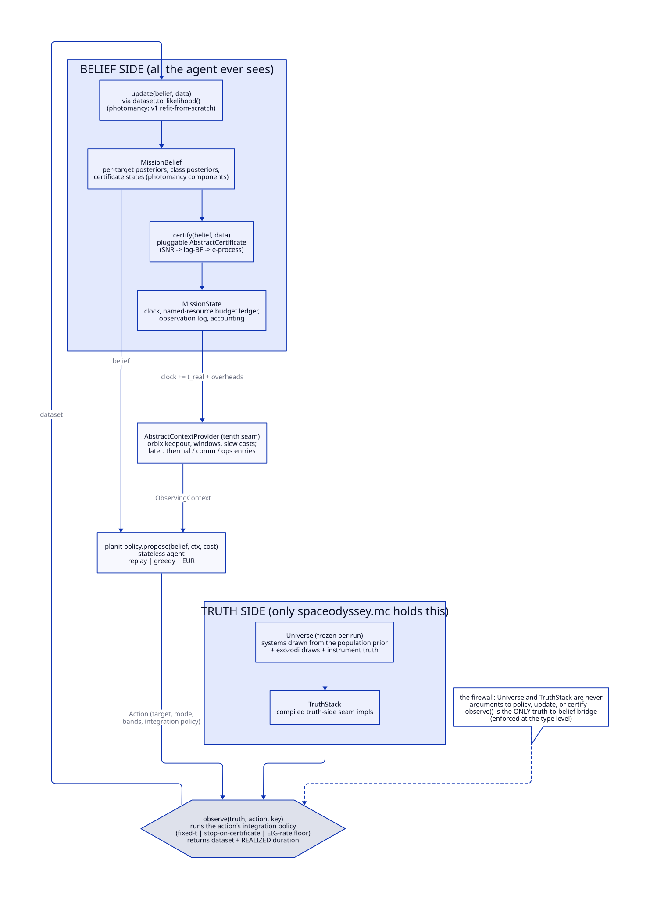
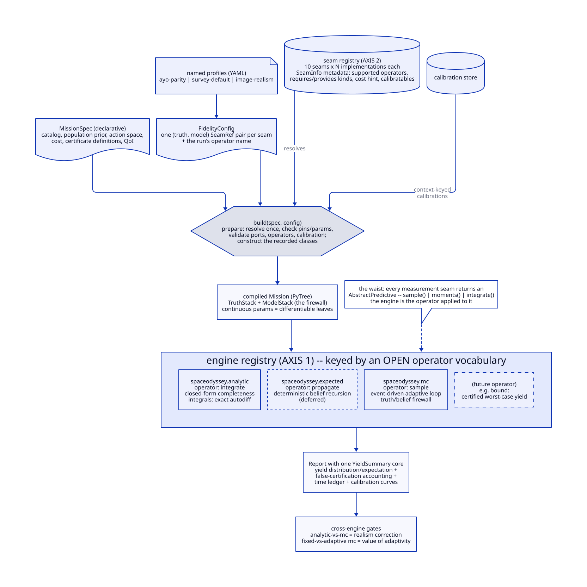

# Architecture

```{note}
spaceodyssey is in the design stage. This page records the architecture the library is
being built toward, so early users and contributors can see where each piece will
land. Interfaces described here will change as the first validation milestones run.
```

## What spaceodyssey is

spaceodyssey is a closed-loop mission simulator and yield calculator for exoplanet
direct-imaging missions, built for the Habitable Worlds Observatory concept. It
plays out a full mission against simulated universes (schedule, observe, update
beliefs, certify detections) and reports certified-yield distributions, time
accounting, and calibration diagnostics.

Classical yield codes such as AYO and EXOSIMS score targets with precomputed
completeness curves and fixed revisit heuristics. spaceodyssey instead carries real
inference in the loop: each target holds a posterior belief that every observation
updates, scheduling policies act on those beliefs, and quantities that classical
codes hardcode (completeness, revisit criteria, characterization time) become
emergent outputs of the simulation.

spaceodyssey owns no physics, no inference, and no policy logic of its own. It is the
composition layer for the HWO simulation suite:

| library | role in spaceodyssey |
| --- | --- |
| skyscapes | astrophysical scenes, target catalogs, population synthesis |
| orbix | orbital propagation, observatory geometry, keepout |
| jaxedith | count rates and integration times |
| coronagraphoto | image-level observation simulation |
| coronachrome | IFS forward model and spectral extraction |
| coronalyze | post-processing and detection statistics |
| photomancy | posteriors, evidence, expected information gain |
| planit-py | scheduling policies and the decision vocabulary |
| yippy / optixstuff / hwoutils | coronagraph performance data, hardware primitives, shared math |



## The environment, the agent, and the belief

The mission loop is a partially observed decision process split across three
libraries. spaceodyssey is the environment: it owns the simulated truth, the clock, the
observation model, and the bookkeeping. planit-py is the agent: a stateless policy
that proposes the next action from the current belief and observing context.
photomancy is the belief update both share.

A strict firewall separates truth from belief. The simulator holds both the drawn
universe and the agent's belief about it, and the only bridge between them is
`observe(truth, action, key) -> data`. The truth container is never an argument to
the policy, the belief update, or realized-data certification. Analytic integration
uses truth to evaluate certification probabilities and score wrong verdicts.
Observations expose `to_likelihood()` factories, so heterogeneous data (detection
outcomes, astrometry, spectra, frames) flow into one belief without spaceodyssey
interpreting any physics itself.



## Two configuration axes

A run is configured along two independent axes, and neither is a global fidelity
knob.

### Axis 1: the outcome operator

Every measurement model returns a predictive distribution. What a run does with
that distribution is the operator, and each operator is served by its own execution
engine:

| engine | operator | what it does | differentiable |
| --- | --- | --- | --- |
| `spaceodyssey.analytic` | integrate | closed-form completeness integrals over the population prior (the AYO limit) | exactly, by autodiff |
| `spaceodyssey.expected` | propagate | a deterministic mission in belief space (preposterior analysis) | end to end |
| `spaceodyssey.mc` | sample | the full adaptive Monte Carlo loop against drawn truths | via policy-gradient or paired-seed estimators |

Engines live in a registry keyed by an open operator vocabulary. Three operators
are known today; a genuinely new evaluation semantics (for example certified
worst-case bounds) would enter as a new registry entry rather than a redesign.
Designs are optimized on the differentiable engines and verified on the sampling
engine, and the residual differences between engines are science outputs in their
own right: the gap between the analytic and sampled mission measures the realism
correction, and the gap between fixed and adaptive schedules measures the value of
adaptivity.

### Axis 2: the per-stage implementation registry

Within a run, fidelity is a property of each pipeline stage, not of the run. Every
stage (scene, instrument, observation, post-processing, characterization,
certification, policy, population, observing context, cost) is an abstract
interface with an unordered registry of implementations, and fidelity is metadata
on a registry entry. Three competing high-fidelity post-processing algorithms are
three entries; an external algorithm plugs in as one more entry wrapped in a
composition adapter.

A `FidelityConfig` picks one entry per stage as a (truth, model) pair, defaulting
equal; deliberately mismatching the pair is how model-misspecification studies are
expressed. Named profiles cover the standard configurations, and an ablation
harness runs paired-seed A/B comparisons that differ in exactly one stage, with
realized false-alarm rates equalized across arms before yield deltas are reported.



### Compatibility: typed wiring contracts

Not every combination of stage implementations makes sense: frame-based
post-processing cannot run on a summary-level count-rate observation model.
Compatibility is therefore formalized rather than documented. Each implementation
declares which contract classes it consumes and produces (summary measurements,
image frames, extracted spectra, detection statistics), the stage graph is fixed,
and validation checks every edge by subtyping before anything runs, together with
operator support and calibration availability. A rejected configuration produces a
message that names the incompatible types and the registry entries that would be
compatible, and a compatibility matrix for any pair of stages can be rendered
straight from the registry metadata. Contract tests verify the declared types
against real behavior, so the metadata cannot drift from the code. The belief side
of the loop needs none of this wiring: every dataset exposes a likelihood factory,
so beliefs, policies, and costs are agnostic to the data kind by construction.



## The calibration cascade

Cheap implementations of a stage are calibrated against expensive ones,
automatically. An implementation may declare a distillation edge, meaning it can
re-fit its parameters from the results of a named costlier implementation (for
example: image-level runs re-fit the summary-level astrometric and photometric
error models; frame-based post-processing re-fits analytic throughput factors; full
spectral retrievals re-fit Fisher-summary inflation factors). Whenever an expensive
implementation runs, every downstream surrogate re-fits on the new results. Fitted
parameters are stored together with their residual distributions in a context-keyed
calibration store, so a cheap run carries surrogate uncertainty as inflated error
bars instead of false precision. Paired cheap and expensive runs also enable
multi-fidelity Monte Carlo estimation: the cheap configuration runs on every
universe, the expensive one on a paired subsample, and the combination gives
variance-reduced high-fidelity yield estimates.

## Runs are datasets

Every run writes a directory with a manifest (specification, configuration, seed
root, library versions, precision flags, calibrations consumed), the observation
log, belief snapshots, and the report. Replay reconstructs a run by rebuilding from
the manifest and loading the logged arrays; live objects are never pickled.
Random-number streams are keyed by (target, epoch, purpose) rather than by call
order, which keeps paired ablation arms aligned even after adaptive trajectories
diverge.

## Validation

The first milestone is parity: with a replayed schedule and inference off, spaceodyssey
must reproduce AYO/EXOSIMS-style expected yields under matched detection models and
matched overhead bookkeeping. Cross-engine consistency checks (the sampling
engine's ensemble mean against the analytic engine; fixed-schedule sampling runs
against the belief-space engine) then become permanent regression tests. Image-level
re-simulation of selected events calibrates the summary-level error models.

## Extending spaceodyssey

Adding a capability is meant to be a bounded, local change:

1. A new algorithm for an existing stage: implement the stage's abstract class (or
   wrap external code in a composition adapter), register it with metadata
   (supported operators, consumed and produced contract types, cost, calibratable
   parameters), and instantiate the stage's contract-test suite.
2. A heavyweight dependency: add it behind an optional extra, with its adapter
   module importing lazily.
3. A genuinely new stage or operator: a deliberate API event with its own abstract
   class or engine, which the registries absorb without redesign.

## Qualified-name compatibility

Contract resolution, lazy module loading, and qualified implementation lookups
use the versioned namespace aliases in `spaceodyssey.aliases` before importing.
A `SeamRef` may name a registered implementation (for example, `snr_threshold`)
or its qualified class (`spaceodyssey.SnrThreshold`). Qualified lookups still
require a unique registration for the selected seam and use its metadata and
availability checks. Seam names and implementation registry keys do not change.

Aliases are applied only during resolution. Reading or rebuilding an older
manifest preserves its original identifiers, library versions, configuration
hashes, run identity, and scientific identifiers. To replay a run, retain its
original manifest instead of replacing qualified names with their new spellings.

The analytic integrate engine reports five weighted yields over all planets:
`y_issued = sum(w * p_pos)`, `y_cert_pos = sum(w * (p_pos - p_wrong))`,
`y_wrong = sum(w * p_wrong)`, `y_neg = sum(w * p_neg)`, and
`y_neg_wrong = sum(w * p_neg_wrong)`. Correct positive yield excludes every
wrong claim, including a wrong water verdict on a true candidate. Each total
has a per-planet contribution column (`issued`, `cert_pos`, `wrong`, `neg`,
`neg_wrong`). `weighted_yields` returns the totals in that order.

Report fields ending in `_se_independent_lower_bound` retain quadrature over
independent planets and are **LOWER BOUNDS**: shared table and common-random-number
errors are not included. The positive-yield error retains the candidate-masked
`p_pos_se` approximation because the outcome provides no positive/wrong
covariance. JSON readers accept the previous `_se` names. Legacy reports retain
their stored positive-yield values; their missing issued column is reconstructed
as `cert_pos + wrong` and cannot recover the former estimand's omitted planets.


## PlanSummary v2

`spaceodyssey.plan.CONTRACT_VERSION` and `PlanSummary.CONTRACT_VERSION` are 2.
The contract uses a leading planet axis P, B spectral bins, V visits, and
Kc correlated-noise factors:

| Field | Shape | Units or meaning |
| --- | --- | --- |
| `bin_wavelength_nm` | (B,) or (P, B) | Spectral bin centres, nm |
| `noise_sigma` | (P, B) | Positive finite independent noise sigma, fractional planet flux |
| `noise_corr_factors` | (P, B, Kc), optional | Correlated factors F, fractional planet flux |
| `noise_known` | (P,) | Boolean: covariance known |
| `spectral_resolution` | (P,) | Resolving power, wavelength / bin width |
| `visit_epochs_d` | (P, V) | Days of mission time |
| `visit_success` | (P, V) | Boolean usable-data mask |
| `visit_photometric_snr` | (P, V) | Nonnegative photometric SNR |
| `spectrum_visit` | (P,) | Integer visit index; -1 means no spectrum |
| `astrometric_precision_mas` | (P, V) | One-sigma precision, mas |
| `rv_precision_ms` | (P,) | Positive precision, m/s; infinity means no mass measurement |

Spectral measurements are normalized by a fixed reference planet flux in
each bin. `noise_sigma` is the standard deviation of that normalized
measurement, in dimensionless fractional planet-flux units, not
planet-to-star contrast. Signal models and factors use the same normalization;
the denominator is never a noisy measured flux. Per-planet covariance is
`diag(noise_sigma**2) + F @ F.T`. Omitting F or using Kc = 0 gives white noise.
`mass_measured` is a derived boolean property, `isfinite(rv_precision_ms)`.

The `snr` field has been removed. Each certifier supplies its own signal and
noise mapping. `ToyGaussianCertifier` assumes unit signal in every bin and
uses `S = sqrt(1.T @ inverse(covariance) @ 1)`, then a posterior standard
deviation `sigma_unit_snr / S`. For white noise, migrate positive v1 SNRs with
`noise_sigma = 1 / snr`; the closed-form probabilities are unchanged. There is
no derived contract SNR because the contract supplies no signal model.
`ToyGaussianCertifier.posterior_sd` now takes a `PlanSummary`.

Missing spectra use `spectrum_visit = -1`, not infinite noise. The toy returns
zero positive and negative certification probabilities if no spectrum is
available, its selected visit failed, or there are no visits. These are valid
zero-yield plans, including in the strict analytic engine. Unknown noise is
outside the toy's validated range and is flagged through `in_range`.
Shapes and spectrum index dtype are checked during tracing; value validation
runs during concrete construction. Validate inputs before passing them to JIT.

## Profiles, truth models, and the claim axis

A `Profile` is an immutable configuration of named `Claim` objects. Each claim
combines one or two inclusive `Edge` thresholds on scalar quantities supplied by
an `AbstractTruthModel`. `Truth` holds parameters and known context for a batch of
planets; the model defines their quantities, prior sets, and expected observations.
`LinearGaussianTruthModel` in `spaceodyssey.testing` supplies a simple reference
model. Its former name, `LinearGaussianTruth`, is a deprecated alias.

Profiles require explicit keyword arguments for `support_rule` and `prior_set_id`.
The reference profiles use `joint` support, bounding the probability that any
reported claim is wrong. `separate` and `split` remain available for per-claim
risk and equally divided familywise risk. The reference profiles declare the
neutral prior-set identifier `exoearth-reference@1`: a compatible truth model must
provide a `PriorSet` with that exact id. Profile names are free-text display labels.

The profile content hash includes the claims, risk, support and evidence rules,
and prior-set id. It excludes the display label. Claim order fixes the output axis;
edge order within a claim and the sign of zero do not change identity.

`AbstractProfileCertificate` checks compatibility before subclass construction
runs, including custom `__init__` and `__check_init__` methods. Constructors must
expose named `profile` and `truth_model` parameters; field converters on these
parameters and hiding them in variadic arguments are rejected. The integrate
engine calls `validate_predictive` to check truth identity, parameter dimensions,
required context, the planet axis, and plan flux references before integrating.
The engine raises `WiringError` if the resulting profile hash differs from the
certificate's hash.
The base `integrate` contract assumes validated inputs; direct callers must
validate unless their concrete integrator does so itself.

`CertificationOutcome` can carry six `(P, K)` claim arrays and ordered
`claim_names`, all present together. Each column describes that claim as a
stand-alone one-claim profile. Profile probabilities describe the combined
certification event. The lowercase hexadecimal `profile_hash` identifies the
configuration. `certified_yield` preserves it and reports weighted `claim_yields`;
`paired_difference` records `profile_hash_a` and `profile_hash_b`, allowing both
same-profile comparisons and comparisons between different profiles.

`GaussianProfileCertifier` (registry key `gaussian_profile`) is a toy for
interface tests. The exact tier is the reference for production comparisons.
The toy uses a declared full-column-rank `spectral_matrix`, known spectral
noise, and a singleton independent Normal prior. The truth model explicitly
opts in with `LINEAR_GAUSSIAN_SPECTRUM = True`, as the testing model does.
Other observation channels are unused. Explicit `flat_prior=True` selects a
support-only improper-flat-prior experiment, ignoring the nominal prior and
bypassing prior evidence; that mode
has no robustness interpretation. A bounded uniform posterior is not Gaussian.

Certification is a condition on the posterior, and certification probability
is over data realizations at fixed truth. The posterior mean is Gaussian over
those realizations. For any linear quantity, a one-sided posterior risk bound
shifts its threshold by a normal critical value times its posterior standard
deviation. An interval claim uses a deterministic, JIT-compatible, 80-step
scalar bisection to find the interval of certifying posterior means; intervals
that are too narrow have no positive support region. The solver evaluates tail
probabilities directly at small alpha. Interval radii use implicit-function
gradients through `jax.lax.custom_root` away from the feasibility boundary.

The toy accepts `separate` and `split` for up to four linearly independent claim
scalars. Quantities may be affine combinations of parameters; two edges within
one claim must reduce to a single scalar interval. Its host-side integration
wrapper runs eagerly on the host, validates inputs and this geometry, and cannot
be jitted, vmapped, or differentiated in any argument. Nonlinear quantities are
rejected before posterior computation. Stand-alone claim columns use the profile
alpha even when the combined event uses `split`. Prior evidence is required for each
report in the proper Gaussian experiment. Negative profile events are unions
of negative reports for positive-counted claims; wrong counted events include
wrong reports of either-counted claims.

Each outcome records `fidelity`: `closed_form` for single thresholds and
independent claim means, or `quadrature` for correlated claim means. Correlated
probabilities use fixed-node Gaussian rectangle integration in claim space,
including the full sampling covariance. Zero standard errors indicate the
absence of Monte Carlo, not a bound on quadrature error.

Multi-claim `joint` profiles raise `UnsupportedProfile` through the base profile
check before any computation. More than four claims and linearly dependent
claim scalars (singular claim covariance) also raise `UnsupportedProfile`, before
posterior computation. These are deliberate limits of rectangle quadrature.
Although joint support regions are convex for interval claims, counting
certification in either direction creates a union of such regions. A library point
estimate needs a tabulated or approximate
tier validated against the exact tier. The reference profiles retain `joint`;
an explicit `separate` variant can exercise this toy with a compatible model.
